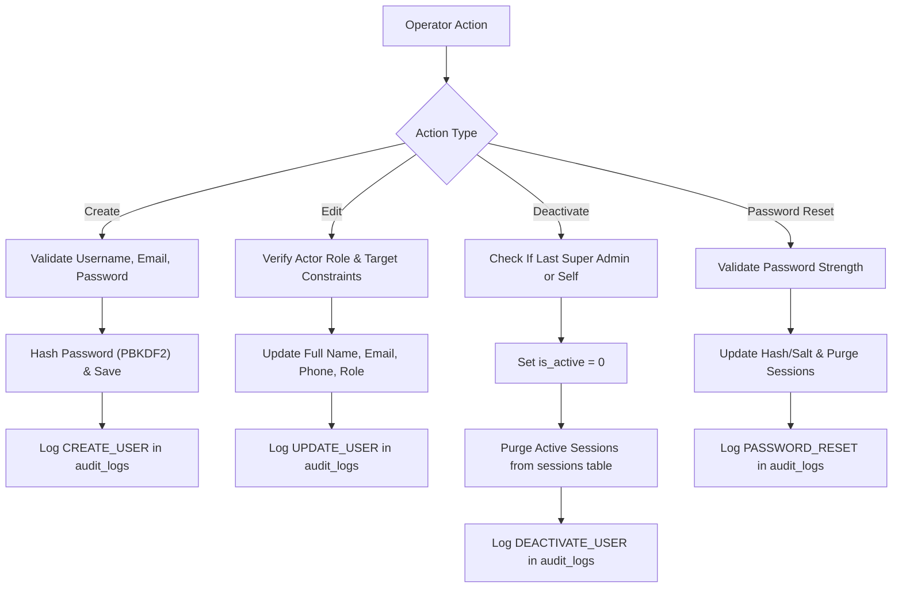

# 👥 Sangita Travels Pune — User Management & Administration Module

This document outlines the user administration module accessible at `#/admin/users` in the Sangita Travels Pune Cab Management System.

---

## 1. Overview & Capabilities

The User Management module provides authorized Super Admins with full lifecycle control over staff, managers, and operational administrators:

- **Search & Filter:** Instant search by name, username, or email with multi-criteria filtering by role and account status.
- **Account Creation:** Form-based account provisioning with server-side validation and password strength enforcement.
- **Profile Editing:** Permitted updates to names, contact numbers, and emails.
- **Role Assignment:** Assignment of approved administrative and operational roles (`SUPER_ADMIN`, `ADMIN`, `MANAGER`, `STAFF`, `CONTENT_MANAGER`, `DRIVER`, `CUSTOMER`).
- **Safe Activation / Deactivation:** Toggle account status without affecting related booking records or transaction ledgers.
- **Password Rotation:** Direct administrative credential rotation with automatic session invalidation.

---

## 2. User Lifecycle Workflows



---

## 3. Server-Side Input Validation Rules

Every account mutation is strictly validated on the server before database persistence:

| Field | Validation Constraint | Rejection Reason |
| --- | --- | --- |
| `username` | `^[a-zA-Z0-9_]{3,30}$` | Must be 3 to 30 alphanumeric characters or underscores. |
| `email` | Standard RFC 5322 regex (`^[^@\s]+@[^@\s]+\.[^@\s]+$`), normalized to lowercase. | Must be a valid email format. |
| `email` (Uniqueness) | Enforced via SQLite unique index `idx_admins_email_unique`. | "Email is already in use by another account." |
| `username` (Uniqueness) | Enforced via SQLite unique constraint on `admins(username)`. | "Username is already in use." |
| `password` | Min 8 chars, >= 1 letter, >= 1 digit. | Must meet complexity requirements. |
| `role` | Must exist in approved `ROLES` configuration dictionary. | "Invalid role specified." |

---

## 4. Account Deactivation vs. Deletion Safeguards

### Safe Deactivation (Recommended)

When an employee leaves or temporary access revocation is required:

- Setting `is_active = 0` revokes all active session tokens immediately.
- The user cannot log in (`HTTP 403: Account has been deactivated`).
- **All historical booking records, driver assignments, and audit trails remain 100% intact.**

### Deletion Protections

- A Super Admin cannot delete their own account.
- The server refuses deletion if the target is the last active `SUPER_ADMIN`.
- Bookings reference customer phone numbers and driver names rather than cascading admin IDs, ensuring zero booking data loss.

---

## 5. API Reference (Protected by RBAC)

All endpoints require `Authorization: Bearer <token>` or an active `admin_token` cookie with `SUPER_ADMIN` privileges.

### `GET /api/users`

Lists administrative accounts.

- **Query Parameters:**
  - `search` (optional): Query string matching username, full name, or email.
  - `role` (optional): Filter by role (`SUPER_ADMIN`, `ADMIN`, `MANAGER`, `STAFF`, etc.).
  - `status` (optional): `active`, `deactivated`, or `all`.
- **Response:**

  ```json
  {
    "success": true,
    "count": 4,
    "users": [
      {
        "id": 1,
        "username": "shital_admin",
        "full_name": "Shital Upadhye",
        "email": "shitalupadhye2001@gmail.com",
        "phone": "8261021008",
        "role": "SUPER_ADMIN",
        "is_active": 1,
        "failed_attempts": 0,
        "last_login": "2026-10-13 14:24:28",
        "created_at": "2026-10-13 08:53:42"
      }
    ]
  }
  ```

  *(Note: `password_hash` and `password_salt` are omitted.)*

### `POST /api/users`

Creates a new staff or admin account.

- **Request Body:**

  ```json
  {
    "username": "rahul_ops",
    "password": "StrongPassword#2026",
    "full_name": "Rahul Deshmukh",
    "email": "rahul@sangitatravels.com",
    "phone": "9822001122",
    "role": "STAFF"
  }
  ```

### `PUT /api/users/:id`

Updates user details, role, status, or credentials.

- **Request Body:**

  ```json
  {
    "full_name": "Rahul Deshmukh",
    "email": "rahul.d@sangitatravels.com",
    "phone": "9822001122",
    "role": "MANAGER",
    "is_active": 1,
    "password": "OptionalNewPassword#2026"
  }
  ```

### `POST /api/users/:id/toggle-status`

Toggles active / deactivated status for an account.

### `DELETE /api/users/:id`

Permanently deletes an account subject to Super Admin safeguards.
